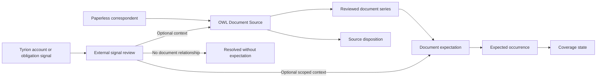

# Document Sources, Expectations, and Coverage

## Decision

OWL will replace the current Correspondent Review and statement-only monitoring
experience with three connected concepts:

1. **Document Sources** reviews Paperless correspondents and records whether
   recurring document policy is relevant.
2. **Document Expectations** defines what should arrive, how it is recognized,
   and when absence matters.
3. **Document Coverage** monitors expected occurrences across statements,
   invoices, tax documents, renewals, records, and other recurring evidence.

Statement Series Detail remains the focused editor for document membership,
split, merge, and reassignment. It does not own expectation policy.

The approved interaction references are:

- [Document Sources](../../mockups/sources-expectations/index.html)
- [Expectation Setup](../../mockups/sources-expectations/expectation-setup.html)
- [Document Coverage](../../mockups/sources-expectations/document-coverage.html)

## Why the current model must change

The existing Correspondent Review page combines directory browsing, analysis,
series grouping, expectation configuration, metadata policy, and external
signal mapping. The existing Statements page combines discovery, membership,
and absence monitoring while naming the entire capability after one document
kind.

Those combinations create three recurring problems:

- most Paperless correspondents do not need recurring-document policy;
- a Tyrion account or obligation is evidence, not another document source; and
- documents can belong to a series even when their absence should not be
  monitored.

The replacement separates the decisions and gives each one a clear completion
state.

## Concept model

### Document Source

A Document Source is an OWL review record anchored to one stable Paperless
correspondent identity. It summarizes observed documents, candidate series,
review history, policy, and optional external relationships.

It is not:

- a generic source from any system;
- a Tyrion account;
- proof that a recurring series exists; or
- a requirement to create an expectation.

The UI may continue to use the familiar word **Correspondents** when showing
the complete Paperless directory. **Document Sources** names the broader OWL
workspace and the reviewed policy record.

### External signal

An External Signal is advisory evidence from Tyrion or another approved
integration. It appears in a separate reconciliation queue until the user:

- links it to a Document Source;
- links it to a specific expectation;
- records that no document relationship is expected; or
- defers it because the evidence is insufficient.

External signals never appear as peer rows in the Paperless correspondent
directory and never create expectations automatically.

### Series

A series answers:

> Which observed documents belong together?

Series membership can be suggested from Paperless history, but user-confirmed
split, merge, add, remove, and reassignment decisions are authoritative. The
focused Statement Series Detail pattern remains appropriate for this job and
should be generalized only as needed for non-statement kinds.

### Expectation

An expectation answers:

> What document should arrive, when does absence matter, how should it be filed,
> and how can it be obtained?

An expectation may refer to a reviewed series, but series membership does not
imply monitoring. Irregular series can remain useful for classification and
filing without generating missing-document findings.

### Coverage

Coverage is the evaluated state of expected occurrences. It answers whether a
qualifying document arrived for a period or deadline and what needs attention.
**Statements** becomes a category filter within Document Coverage rather than
the name of the overall monitoring product.

## Source review model

### Queue modes

The left rail has three stable modes:

| Mode | Purpose |
|---|---|
| **Needs review** | Sources reopened by new evidence or sources that do not yet have a durable disposition |
| **External signals** | Unresolved Tyrion account or recurring-obligation candidates |
| **All correspondents** | Complete Paperless correspondent directory, including one-off and intentionally inactive sources |

Search applies within the selected mode. A compact filter popover provides
review reason, disposition, evidence, and system-relationship filters without
permanently consuming rail width.

### Source dispositions

Every reviewed source receives one durable disposition:

| Disposition | Meaning | Monitoring effect |
|---|---|---|
| **Expectations configured** | One or more active expectations intentionally exist | Eligible expectations appear in Coverage |
| **No series expected** | Documents from this source are one-off or recurrence is not meaningful | No source-level recurring review until evidence changes |
| **Waiting for more history** | Evidence is too sparse to make a durable decision | Revisit on a chosen date or material new evidence |
| **Ignored or retired** | The source should not participate in active source intelligence | No analysis or monitoring until explicitly restored |

**Needs review** is a workflow state, not a durable disposition. It means a
source requires a decision because it is new, its evidence changed, or a prior
waiting condition matured.

Source-level **No series expected** is distinct from expectation-level
`not_expected`:

- source-level disposition says the correspondent currently has no meaningful
  recurring document series;
- expectation-level `not_expected` resolves one specific candidate or external
  signal as not implying a document.

### Reopening rules

Reviewed sources should reopen because evidence changed, not merely because
time passed:

- a new Paperless document arrives;
- a repeatable pattern becomes detectable;
- a new Tyrion relationship is proposed;
- confirmed series membership or metadata materially changes;
- the Paperless correspondent is merged, deleted, or relinked; or
- an optional revisit date for **Waiting for more history** arrives.

An unchanged **No series expected** source must not return to Needs Review on a
generic periodic schedule.

## Tyrion relationship model

OWL supports two independent optional relationships:

1. **Account or obligation → Document Source** provides institution, payee, or
   ownership context for the Paperless correspondent.
2. **Account or obligation → Document Expectation** identifies which specific
   expected series the external signal supports.

A source link must not automatically create or choose an expectation. One
Paperless correspondent can relate to several Tyrion accounts, one account can
support several document expectations, and many correspondents have no Tyrion
relationship.

The relationship stores opaque Tyrion references and user-safe account labels.
Tyrion remains authoritative for account and obligation facts. OWL remains
authoritative for the reviewed mapping and document policy.

## Primary workflows

### Review a Paperless correspondent

1. Open **Needs review** or find a correspondent in **All correspondents**.
2. Run **Analyze history** when no reviewed series exists, then confirm any
   candidate grouping that represents real document membership or dismiss a
   false candidate so it remains excluded from future analysis.
3. Review representative documents and current external relationships, and
   correct series membership when needed.
4. Choose **Configure expectations**, **No series expected**,
   **Waiting for more history**, or **Ignore / retire**.
5. Record the decision and advance to the next source.

### Correct detected and reviewed membership

Source discovery reads stored account metadata and extracts masked account suffixes
from existing Paperless OCR text without running individual document analysis,
invoking an LLM, or writing metadata back to Paperless. Conflicting OCR identifiers
remain unresolved. Account evidence outranks generic filing-title variants;
annual summaries and notices remain distinct from regular statements.

The confidence shown on a detected group describes **cadence**, not account
identity. Inspect the document evidence before confirming a relationship.

Select multiple detected groups of the same kind with **Include in combined
review**, inspect the combined documents, uncheck outliers, and name the reviewed
series. Alternatively choose a **Destination series** to append the selected
documents to an existing reviewed series. Confirmed membership survives later
analysis, including deliberate grouping across replacement-card suffixes.
Different suffixes are never automatically inferred to be the same account.

Both source review and the membership editor show document titles, dates, types,
tags, masked account evidence, and uncropped 96-by-116-pixel thumbnails. **Open**
uses a right-side preview with previous/next navigation; **New tab** remains an
explicit alternative. The preview fills the viewport width on narrow screens.

The membership editor's **Add documents from this source** searches unassigned
documents by title, date, type, tag, account suffix, or ID. Selection and preview
replace the ID-only add field. Appending is transactional and idempotent, preserves
existing members, rejects documents from another source or reviewed series,
invalidates cached detection, and does not change expectation policy.

### Reconcile an external signal

1. Open **External signals** and inspect Tyrion provenance.
2. Search for a Paperless correspondent using advisory names and known aliases.
3. Link the signal to the source, and optionally to a specific expectation.
4. If no document should exist, record that durable scoped result.
5. If evidence is insufficient, defer without inventing a match.

### Configure an expectation

1. Name the expected document and optionally select a reviewed series. A user
   may define policy before any document exists or while OWL has not identified
   existing documents as a series.
2. Choose recurring, periodic, one-off, irregular, or not expected.
3. Define schedule, availability window, importance, and missing-document
   behavior only when absence is meaningful.
4. Define recognition and filing policy.
5. Record acquisition guidance and an optional Tyrion relationship.
6. Review the plain-language policy summary, then save a draft or confirm the
   active policy.

### Monitor coverage

1. Open Document Coverage and filter by state, importance, source, or document
   kind.
2. Review missing, late, due-soon, fulfilled, or intentionally unmonitored
   occurrences.
3. Inspect the expectation and recent documents.
4. Retrieve the document, extend the grace period, reassign a near match,
   correct policy, or retire the expectation.
5. Verify that a newly ingested Paperless document fulfills the occurrence.

## Navigation and route intent

| Intended surface | Route intent | Replaces or absorbs |
|---|---|---|
| Document Sources | `/sources`, with optional source deep link | Current `/correspondents` workspace |
| Expectation Setup | Source or series scoped flow under `/sources` | Expectation controls scattered across correspondent and statement pages |
| Document Coverage | `/coverage`, with statement and other kind filters | Current `/statements` overview |
| Series Detail | Series-scoped detail under `/coverage` or `/sources` | Current `/statements/:seriesId`, retaining membership correction |

Legacy `/correspondents` and `/statements` URLs may redirect to canonical
destinations during rollout, but old components, CSS, data contracts, and
duplicate navigation entries must be removed once the replacement is active.
Compatibility redirects must not keep an obsolete implementation alive.

## Replacement and migration guidance

The prior Correspondent Review implementation was never fully operational.
Preserving its data shape is not a product requirement. Implementation may
reset or rebuild local correspondent review, candidate, expectation, and
coverage data where that produces a clearer contract.

The replacement must:

- use stable Paperless correspondent identity rather than display-name joins;
- model source disposition separately from expectation mode and status;
- keep source and expectation Tyrion links separate;
- preserve reviewed series membership decisions;
- remove statement-only assumptions from coverage evaluation;
- delete unused routes, components, CSS, APIs, and schema paths rather than
  leaving dormant compatibility code; and
- retain auditability for new user decisions even if legacy review data is
  intentionally discarded.

## Non-goals

- Treating every Paperless correspondent as recurring.
- Treating Tyrion entities as document sources.
- Automatically creating expectations from transaction or account data.
- Turning Document Sources into another general document browser.
- Moving Paperless-native metadata authority into OWL.
- Generalizing series membership so aggressively that statement correction
  becomes less precise.

## Validation scenarios

Implementation is not complete until these cases are clear:

1. A one-document Venmo correspondent can be marked **No series expected** and
   disappears from Needs Review.
2. A later repeated document or new Tyrion signal reopens that source with a
   specific reason.
3. A bank correspondent can link to multiple Tyrion accounts without creating
   expectations automatically.
4. One bank account can be linked to a checking-statement expectation while a
   separate tax-document expectation remains unlinked.
5. An irregular series remains available for recognition and filing but never
   emits a missing occurrence.
6. A statement, annual tax form, and insurance renewal appear together in
   Document Coverage with kind-specific filters.
7. Correcting series membership updates coverage without silently rewriting
   the expectation policy.
8. A user can confirm an expectation with no reviewed series, see missing or
   upcoming coverage, manually assign a qualifying Paperless document, and
   attach a reviewed series later without recreating policy.
