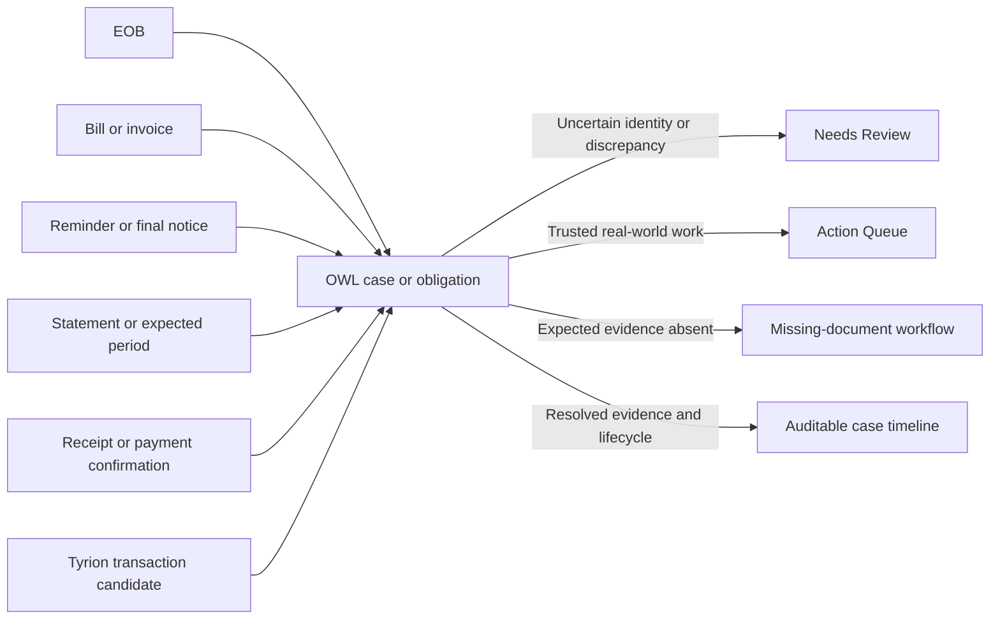
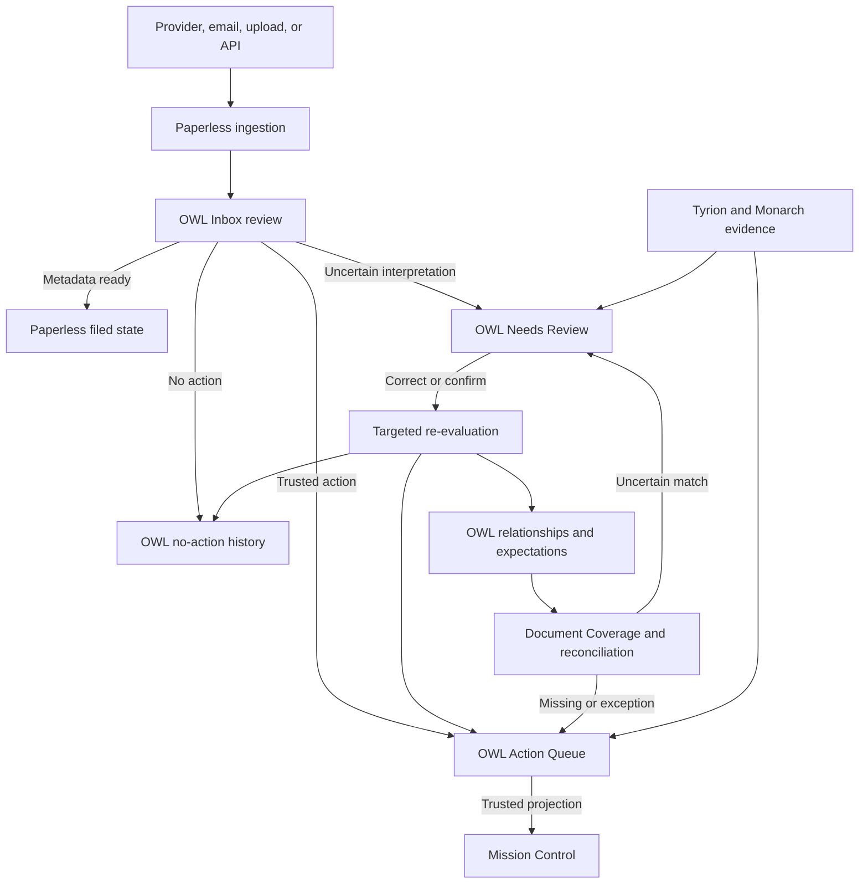
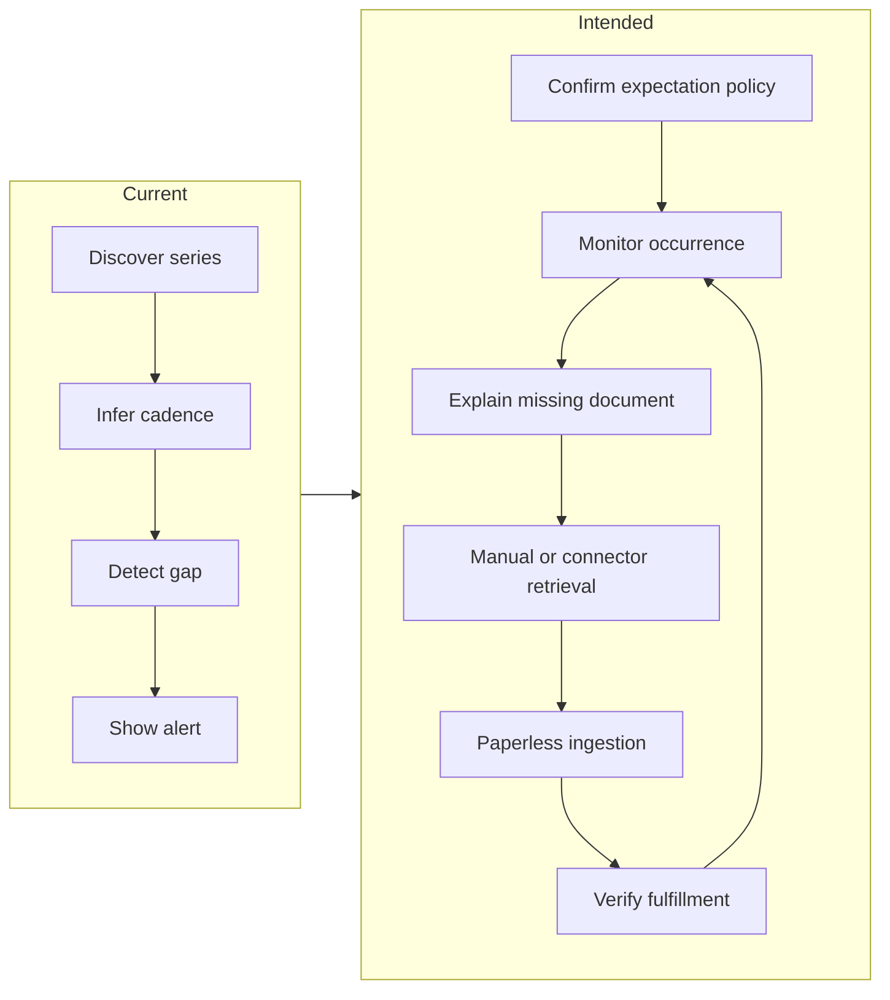

# OWL Use Case Catalog and User Journeys

## Purpose

This document is the canonical product-level catalog of the outcomes OWL helps
one household operator achieve. It organizes OWL around user decisions and
end-to-end journeys rather than pages, modules, or implementation components.

It also defines the handoffs among Paperless-ngx, OWL, Mission Control, Tyrion,
and acquisition tools. Feature-level design documents remain authoritative for
their detailed algorithms, schemas, and APIs.

## Product boundary

> Paperless owns the archive and native metadata. OWL owns evidence-rich
> interpretation, review, relationships, and action assessment. Mission Control
> prioritizes trusted work across systems. Tyrion and Monarch own financial
> account and transaction evidence. Acquisition tools retrieve documents but do
> not decide whether those documents are required.

| System | Owns | Does not own |
|---|---|---|
| **Paperless-ngx** | Files, OCR, versions, native metadata, saved views, archive browsing | OWL decisions, relationships, action lifecycle, expected-but-absent documents |
| **OWL** | Review evidence, governed enrichment, action assessments, Needs Review, relationships, recurrence expectations, decision history | Original document storage, financial ledger truth, general cross-system task planning |
| **Mission Control** | Cross-system prioritization and presentation of trusted actionable work | Document interpretation, metadata readiness, uncertain review, OWL relationship truth |
| **Tyrion / Monarch** | Financial accounts, recurring financial signals, transactions, bounded payment candidates | Paperless document identity, statement availability, document cadence policy |
| **Acquisition tools** | Provider, email, API, or manual retrieval execution and connector health | Whether a document is expected or whether retrieved evidence is sufficient |

## Core decision model

The catalog keeps four related decisions separate:

| Decision | Primary question | Authoritative system | Typical outcome |
|---|---|---|---|
| **Metadata readiness** | Is this document filed well enough to leave the Inbox? | Paperless state, reviewed through Paperless or OWL | Save metadata, remove configured Inbox tag, or defer |
| **Interpretation trust** | Does OWL understand the document or relationship well enough to proceed? | OWL Needs Review | Confirm, correct, reject, match, split, merge, or re-evaluate |
| **Action lifecycle** | What should the operator do because of this evidence? | OWL Action Queue | Complete, snooze, dismiss, mark not an action, or reopen |
| **Expectation fulfillment** | Was an expected document received, and what should happen if it is missing? | OWL expectation policy | Fulfill, wait through grace period, retrieve, defer, or revise policy |

This establishes the key distinction:

- **Needs Review determines what OWL should believe.**
- **Action Queue tracks what the operator should do.**
- **Inbox review determines whether Paperless metadata is ready.**
- **Document Coverage determines whether expected evidence arrived.**

## Use case catalog

Status describes the product capability, not whether every UX detail is
complete:

- **Current** — supported by the current application and contracts.
- **Evolving** — partly implemented, with active design or UX work remaining.
- **Planned** — a defined target that must not be presented as working today.

### Organize: make documents usable and trustworthy

| ID | Use case | User outcome | Primary owner | Status |
|---|---|---|---|---|
| O-1 | Review Inbox metadata | Understand the document and see current Paperless metadata, native suggestions, and OWL-derived facts together | Paperless + OWL review UI | Evolving |
| O-2 | Correct and finalize metadata | Accept, edit, remove, or replace title, correspondent, document type, date, tags, storage path, and governed custom fields | Paperless for native metadata; OWL for governed fields | Current / evolving |
| O-3 | File a document | Remove only configured intake tags when metadata is ready, independently of action status | Paperless, invoked from OWL or Paperless | Current |
| O-4 | Record no action needed | Preserve a reviewable no-action decision without excluding later matching or re-analysis | OWL | Evolving |
| O-5 | Correct OCR-derived information | Compare source evidence, correct extracted facts, or review a safer OCR candidate without replacing the original silently | OWL review; Paperless versions | Planned / evolving |
| O-6 | Find a purposeful document view | Open Paperless-backed saved views or OWL-native derived queues without creating another document browser | Paperless or OWL, by provider | Current |

### Watch: identify work, gaps, changes, and exceptions

| ID | Use case | User outcome | Primary owner | Status |
|---|---|---|---|---|
| W-1 | Review document actions | See trusted or proposed PAY, RESPOND, SIGN, SCHEDULE, SHARE, REVIEW, and other real-world work with source evidence | OWL | Current |
| W-2 | Maintain an action | Add, edit, correct, complete, snooze, dismiss, mark not an action, or reopen an action | OWL | Current / evolving |
| W-3 | Capture action facts | Retain amount, due date, payee, account context, notes, links, and other action-relevant evidence with provenance | OWL; governed Paperless projection where useful | Current / evolving |
| W-4 | Resolve an uncertain interpretation | Decide uncertain classification, no-action, metadata conflict, OCR quality, match, grouping, duplicate, or relationship proposals | OWL Needs Review | Current / evolving |
| W-5 | Review a document source | Review a Paperless correspondent, inspect representative evidence, and record expectations configured, no series expected, waiting for history, or ignored/retired | OWL source profile anchored to Paperless correspondent identity | Evolving |
| W-6 | Establish document expectations | Define recurring, periodic, one-off, irregular, or not-expected policy below a reviewed source | OWL | Evolving |
| W-7 | Reconcile external document signals | Map bounded Tyrion account or obligation candidates to a Paperless-anchored source and optionally a specific expectation, or record that no document relationship exists | Tyrion evidence; OWL reviewed relationship | Evolving |
| W-8 | Curate document series | Discover and correct statement, utility, insurance, payroll, tax, and other series membership through split, merge, add, remove, and reassignment decisions | OWL | Current / evolving |
| W-9 | Monitor document coverage | Evaluate missing, late, due-soon, fulfilled, and intentionally unmonitored occurrences across document kinds | OWL | Current / evolving |
| W-10 | Retrieve a missing document | Create a manual follow-up or invoke an approved email/API acquisition path, then verify that the expected occurrence was fulfilled | OWL policy/action; external acquisition execution | Planned / evolving |
| W-11 | Detect changed or stale evidence | Re-evaluate affected results after material metadata, file, OCR, analyzer, or relationship changes | OWL | Evolving |

### Learn: connect evidence and improve future decisions

| ID | Use case | User outcome | Primary owner | Status |
|---|---|---|---|---|
| L-1 | Relate documents | Connect reminders, revisions, receipts, bills, statements, and supporting records without destroying either source | OWL | Current |
| L-2 | Resolve duplicate or grouping proposals | Confirm duplicate, keep both and link, split or merge a series, or reject an incorrect grouping | OWL | Current |
| L-3 | Reconcile EOBs and medical bills | Compare extracted evidence, confirm or reject matches, find alternatives, and track payment state | OWL | Current |
| L-4 | Check payment evidence | Ask Tyrion for bounded transaction candidates and explicitly confirm a posted payment before completing an obligation | Tyrion evidence; OWL lifecycle | Current / evolving |
| L-5 | Verify downstream effects | See what changed, whether Paperless or Mission Control projection succeeded, and whether re-analysis completed | OWL audit and projection state | Evolving |
| L-6 | Learn from corrections | Retain human decisions as evaluation and future suggestion evidence without allowing an unchanged model rerun to overwrite them | OWL | Evolving |

## Primary end-to-end journeys

### Journey 1: Clear a newly ingested document

**Trigger and context:** A document arrives in Paperless through upload, email,
workflow, or an optional acquisition tool. It has an Inbox tag or appears in a
configured intake view.

**Desired outcome:** The document is recognizable, filed accurately, assessed
for real-world work, and advanced without hiding uncertainty.

**Evidence needed:** Source preview, OCR/source readiness, current Paperless
metadata, Paperless ML and AI suggestions, OWL-derived facts, action reasoning,
confidence, provenance, and analysis freshness.

**Current entry points:** `/inbox`, `/inbox/:documentId`, `/document-views`, or
a Paperless saved view.

**Happy path:**

1. Open the next intake document with its source preview visible.
2. Compare current metadata with deterministic, Paperless-native, and
   OWL-derived suggestions.
3. Accept or edit proposed values.
4. Review the current action assessment without treating filing as action
   completion.
5. Choose one explicit outcome:
   - **Save & file**;
   - **Confirm action & file**;
   - **File — no action needed**; or
   - **Defer & next**.
6. If a material input changed, OWL marks prior analysis stale and re-evaluates
   against the new source fingerprint.

**Alternate and recovery paths:**

- Unstable OCR or file processing remains visibly in progress.
- A concurrent Paperless edit causes a refresh-and-compare conflict, never a
  silent overwrite.
- Uncertain action or no-action classification routes to Needs Review but does
  not block metadata editing.
- Paperless writeback failure preserves the OWL decision as partial success and
  offers retry.
- Empty queues explain how the intake scope is configured rather than implying
  that Paperless contains no documents.

**Data conditions:** One document supports focused review; a typical queue
supports keyboard-driven sequential processing; a high-volume queue requires
stable ordering, visible progress, filters, and no repeated loading of unchanged
source evidence.

### Journey 2: Complete or defer trusted work

**Trigger and context:** OWL has a confident or human-confirmed action, or
Mission Control surfaces a trusted OWL action among work from other systems.

**Desired outcome:** The operator understands the obligation, acts, records the
correct lifecycle state, and can explain later why that state exists.

**Evidence needed:** Source document, action type, amount, due date, payee or
recipient, relevant links, confidence and reasons, related notices or receipts,
freshness, and projection state.

**Current entry points:** `/actions`, a canonical action deep link, or a trusted
Mission Control item.

**Happy path:**

1. Open the highest-priority trusted action.
2. Review the source and extracted action facts.
3. Perform the real-world work or use an approved source action.
4. Mark the action done, snooze it, dismiss it, or correct it as not an action.
5. Advance to the next action while retaining the audit event and Paperless
   synchronization result.

**Alternate and recovery paths:**

- Incorrect classification is corrected or routed to Needs Review.
- A later reminder raises priority without creating an unrelated duplicate
  obligation.
- Payment candidates remain evidence until a posted transaction is explicitly
  confirmed.
- A stale revision, source outage, or projection failure remains distinct from
  successful completion and supports safe retry.
- Mission Control deep-links specialist interpretation back to OWL rather than
  attempting to own it.

**Data conditions:** The minimum is one action; the typical case is a short
daily queue; the high-volume case requires priority ordering, sequential
navigation, bulk-safe filtering, and clear separation between trusted and
proposed work.

### Journey 3: Resolve what OWL should believe

**Trigger and context:** OWL cannot safely decide a classification,
relationship, duplicate, grouping, metadata conflict, OCR assessment, or
no-action result.

**Desired outcome:** A human establishes a trusted interpretation or explicitly
defers it, with the evidence and downstream consequences visible.

**Evidence needed:** Review type, reason, confidence, age, priority, source
documents, extracted facts, alternatives, conflicts, provenance, and predicted
effect of each decision.

**Current entry points:** `/needs-review`; specialist deep links from EOB,
statement, duplicate, metadata, relationship, or OCR surfaces.

**Happy path:**

1. Select a review item based on type, reason, priority, and age.
2. Inspect the source and comparison evidence.
3. Confirm, correct, reject, match, split, merge, mark no action, or request
   re-evaluation.
4. OWL records the decision and reprocesses only the affected interpretation.
5. The result may create or update an Action Queue item, a relationship,
   metadata writeback, or no downstream work.

**Alternate and recovery paths:**

- **Review later** preserves the unresolved item without fabricating trust.
- Missing source documents, unavailable Paperless, and failed analyzers remain
  explicit blocked or failed states.
- A bulk operation is available only where every selected item has the same
  safe decision semantics; OCR reviews are excluded from generic acceptance.
- A corrected decision can be reversed without deleting the earlier audit
  history.

**Data conditions:** Mixed review types require type-specific details inside a
consistent workspace. At high volume, filters, reason codes, batching policy,
sampling, and aging/escalation are more important than one undifferentiated
count.

### Journey 4: Review document sources and external signals

**Trigger and context:** A Paperless correspondent is new, has materially new
evidence, reaches a requested revisit date, or has an unresolved Tyrion account
or obligation signal.

**Desired outcome:** The operator decides whether recurring-document policy is
relevant without forcing every Paperless correspondent into a series.

**Evidence needed:** Stable Paperless correspondent identity, representative
documents, observed patterns, candidate series, prior disposition and reopening
reason, aliases, and bounded Tyrion provenance when present.

**Intended entry points:** `/sources`, its Needs review, External signals, and
All correspondents modes, or a source-specific deep link. Legacy
`/correspondents` routes may redirect during rollout.

**Happy path:**

1. Select a source from **Needs review**, or find one in the full Paperless
   correspondent directory.
2. Review representative documents, candidate series, evidence quality, and
   optional external relationships.
3. Correct obvious series membership when necessary.
4. Choose one durable source outcome:
   - **Expectations configured**;
   - **No series expected**;
   - **Waiting for more history**; or
   - **Ignored or retired**.
5. If reviewing an external signal, link it to the Paperless-anchored source,
   optionally link it to a specific expectation, or record that no document
   relationship exists.

**Alternate and recovery paths:**

- A one-off correspondent such as a person named on one Venmo receipt can be
  marked **No series expected** without creating a negative expectation.
- An unchanged reviewed source stays out of Needs review; a new document,
  repeatable pattern, new Tyrion relationship, membership correction, or
  explicit revisit date can reopen it with a reason.
- Sparse evidence can be deferred as **Waiting for more history** without a
  guessed cadence.
- Conflicting Paperless and Tyrion evidence remains unresolved rather than
  matching by display name.
- A renamed Paperless correspondent retains identity; a deleted or merged one
  requires explicit relinking or retirement.

**Data conditions:** The complete Paperless directory may contain many
one-document correspondents. Needs review must remain a curated exception
queue, while the full directory requires search and filters for review reason,
disposition, evidence, and system relationship.

### Journey 5: Configure an expectation and curate its series

**Trigger and context:** A reviewed source has one or more meaningful document
series, or the operator defines a required document despite sparse history.

**Desired outcome:** The operator establishes explicit policy for what should
arrive, how it is recognized, when absence matters, how it should be filed, and
how it can be obtained.

**Evidence needed:** Representative Paperless documents, reviewed series
membership, observed cadence and exceptions, title/tag/type patterns, series
discriminators, and optional Tyrion account or obligation context.

**Intended entry points:** Expectation Setup from `/sources`; series detail from
`/coverage` or `/sources`. The statement-series editor remains the focused
membership correction pattern.

**Happy path:**

1. Select or name the document series and correct its members through add,
   remove, split, merge, or reassignment.
2. Define the expectation as recurring, periodic, one-off, irregular, or not
   expected.
3. Confirm cadence or calendar rule, availability window, grace period, and
   importance only when absence is meaningful.
4. Confirm recognition, metadata, title, and acquisition policy.
5. Optionally link a specific Tyrion account or obligation to this expectation;
   a source-level Tyrion link does not choose an expectation automatically.
6. Review the plain-language policy summary before saving.

**Alternate and recovery paths:**

- Sparse history permits manual policy rather than requiring inferred cadence.
- An irregular series supports recognition and filing but does not emit missing
  occurrences.
- Expectation-level `not_expected` resolves a specific candidate or external
  signal; it is distinct from source-level **No series expected**.
- Correcting series membership updates matching and coverage without silently
  rewriting expectation policy.
- Dismissed suggestions remain review history, not durable expectation modes.

**Data conditions:** A simple source has one series; a financial institution
may have several accounts and document kinds. High-volume archives require
reviewed membership, bounded scans, and account-safe labels rather than raw
identifiers.

### Journey 6: Detect and recover a missing document

**Trigger and context:** A confirmed expectation passes its availability window
and grace period without a qualifying Paperless document.

**Desired outcome:** The operator understands the gap, obtains the document or
revises the expectation, and can verify fulfillment.

**Evidence needed:** Expected series and period, last received document,
cadence/calendar policy, grace and escalation rules, acquisition guidance,
connector health, and any near-match documents.

**Intended entry points:** `/coverage`, expectation or series detail, Overview,
Insights, or a trusted Mission Control alert. Legacy `/statements` routes may
redirect to the statement-filtered coverage view during rollout.

**Happy path:**

1. OWL identifies the missing occurrence and explains why it is overdue.
2. The operator checks near matches and confirms that the document is truly
   absent.
3. OWL creates a manual retrieval action or invokes an explicitly approved
   acquisition connector.
4. The retrieved document enters Paperless through the normal ingestion path.
5. OWL matches it to the expected occurrence, closes the gap, and retains the
   acquisition and fulfillment history.

**Alternate and recovery paths:**

- **Wait / extend grace period** handles known delays without discarding policy.
- **Not expected / retire expectation** corrects bad policy.
- **Reassign document** repairs a wrong series match.
- Connector failure creates a visible acquisition failure or manual fallback,
  not a fulfilled occurrence.
- A near match with uncertain identity routes to Needs Review.

**Data conditions:** The minimum is one missing occurrence; typical review
groups gaps by urgency and importance; high volume requires deduplication,
escalation control, connector rate limits, and suppression of repeated alerts
for the same occurrence.

### Journey 7: Reconcile a multi-document case or obligation

**Trigger and context:** Several documents or external evidence may describe
the same claim, obligation, account period, purchase, payment, or evolving
notice sequence. Examples include an EOB and provider bill; an invoice followed
by reminders or a final notice; a bill and receipt; or a statement period and
the documents that explain its transactions.

**Desired outcome:** The operator sees one coherent case or obligation without
losing the distinct source documents. OWL records what each document represents,
how the evidence is related, what remains unresolved, and whether the combined
evidence changes an action or expected-document lifecycle.

**Evidence needed:** Side-by-side document summaries, exact identifiers,
provider/account context, dates, amounts, match factors, relationship direction,
confidence, alternatives, current lifecycle, coverage or balance differences,
and provenance for external payment evidence.

**Current entry points:** `/eob`, `/orphans`, `/statements`,
`/statements/:seriesId`, action relationship views, payment checks, and Needs
Review.

**Relationship patterns:**

| Document set | User question | OWL representation | Status |
|---|---|---|---|
| EOB ↔ provider bill | Do these records describe the same medical service, and do the amounts reconcile? | Scored match, factor evidence, coverage difference, payment lifecycle | Current |
| Bill or invoice ↔ reminder / past-due / final notice | Is this a later notice for the same obligation, and should urgency increase? | `follows` or `supersedes` relationship plus one consolidated obligation timeline | Current |
| Bill or invoice ↔ receipt / payment confirmation | Does this document support payment of the obligation? | `supports` relationship and payment evidence; completion remains explicit | Current / evolving |
| Bill or invoice ↔ Tyrion transaction candidate | Is there a posted transaction that may settle this obligation? | Privacy-bounded payment candidate; explicit confirmation required | Current / evolving |
| Statement ↔ recurring series / expected period | Does this document belong to the expected series and fulfill the period? | Series membership and expectation occurrence fulfillment | Current |
| Statement transaction ↔ receipt or invoice | Which source document explains a statement line item, and is anything missing or duplicated? | Generalized reconciliation recipe and reviewed evidence links | Planned |
| Order or contract ↔ invoice ↔ shipping / fulfillment evidence | Do these documents represent one purchase or contractual sequence? | Generalized case with typed members, matches, and lifecycle events | Planned |

**Happy path:**

1. OWL identifies an anchor document or existing case and searches only bounded,
   eligible candidates.
2. The operator compares the source documents, extracted facts, match factors,
   alternatives, and any amount or period discrepancy.
3. Confirm the appropriate typed result: match, `follows`, `supersedes`,
   `supports`, `same_sequence`, series membership, or expectation fulfillment.
4. OWL preserves each source document and adds it to the case timeline with its
   distinct role.
5. OWL recalculates the affected obligation, balance, urgency, action,
   expectation, or payment state without inventing settlement.
6. Later notices, receipts, statements, or external candidates extend the same
   case rather than creating unrelated duplicate work.

**Alternate and recovery paths:**

- Rejecting a candidate preserves every document and the review decision.
- **Keep both and link** distinguishes related documents from true duplicates.
- Conflicting provider, account, invoice, claim, amount, or period evidence
  fails closed and remains in Needs Review.
- A missing counterpart remains an explicit open case state: EOB without bill,
  bill without EOB, invoice without receipt, or statement item without evidence.
- Partial, ambiguous, pending, stale, possible double-payment, and overpayment
  states remain distinct rather than collapsing into paid or complete.
- Removing or changing a relationship rebuilds only the affected case and can
  split previously consolidated actions.
- Source or projection failures preserve the authoritative OWL case and expose
  safe retry separately.

**Data conditions:** A simple case compares two documents. Typical cases include
an original bill, one or more notices, a receipt, and a payment candidate.
High-volume matching requires bounded candidate generation, explainable ranking,
idempotent relationship creation, one-to-many and many-to-many support, and
case-level rather than document-level queue deduplication.

### Journey 8: Correct a decision and verify downstream effects

**Trigger and context:** Metadata, OCR-derived facts, a match, relationship,
grouping, action classification, or prior analysis is incorrect or stale.

**Desired outcome:** The operator safely corrects the authoritative decision,
OWL updates only affected downstream results, and every authoritative and
projected change remains visible, auditable, and reversible.

**Evidence needed:** Current and proposed values, source preview, prior decision
and provenance, affected actions or relationships, source fingerprint, expected
re-analysis, and Paperless/Mission Control projection status.

**Current entry points:** `/metadata/:docId`, `/corrections`, `/history`,
`/ocr-quality/documents/:documentId`, specialist review surfaces, and Needs
Review.

**Happy path:**

1. Open the incorrect decision from its document, case, review item, or history.
2. Compare current source evidence with the stored interpretation.
3. Preview and confirm the correction.
4. OWL records before-and-after state and re-evaluates only affected results.
5. Verify the authoritative OWL result and the separate Paperless and Mission
   Control projection states.

**Alternate and recovery paths:**

- Projection failure does not roll back a valid OWL relationship; repair is
  available from Action Queue Operations.
- A correction can split a previously consolidated obligation and restore each
  action's pre-relationship values.
- Re-analysis failure leaves the prior result visibly stale rather than
  silently treating it as current.
- A concurrent Paperless edit requires refresh and comparison before writeback.
- Reversing a correction restores coherent state without erasing the original
  decision or the reason it was changed.

**Data conditions:** A single correction should remain focused and explainable.
Bulk migration or repair requires preview-before-apply, bounded scopes, durable
run progress, idempotency, per-item failures, and an aggregate result that does
not hide partial success.

## End-to-end routing

## Current-to-intended recurring-document flow

The current product can discover series and gaps, but retrieval and fulfillment
need a more explicit closed loop.

## Frontend surface coverage

Every current route is either a primary journey entry, a specialist step, a
supporting operational surface, or a compatibility redirect.

| Surface | Role | Journey coverage |
|---|---|---|
| `/` Overview | Cross-journey attention summary and entry point | 1–8 |
| `/inbox`, `/inbox/:documentId` | Primary intake workspace | 1 |
| `/actions` | Primary trusted-action workspace | 2 |
| `/needs-review` | Primary uncertain-belief workspace | 3; supports 1, 4–8 |
| `/document-views` | Read-only launcher to Paperless or OWL review scopes | 1, 3–8 |
| `/sources` and source deep links | Paperless correspondent review, source disposition, external-signal reconciliation, and expectation entry | 4–5 |
| `/coverage` and series/expectation detail | Cross-kind occurrence monitoring, missing-document recovery, and reviewed series membership | 5–7 |
| Legacy `/correspondents` and `/statements` routes | Temporary compatibility redirects to Sources or statement-filtered Coverage, not separate implementations | 4–6 |
| `/eob` | Specialist medical reconciliation workspace | 7 |
| `/eob/benchmarks` | Supporting evaluation and calibration | 7 |
| `/eob/manual-search`, `/needs-review/manual-search` | Specialist recovery for unresolved medical matches | 3, 7 |
| `/orphans` | Duplicate, orphan, relationship, and bounded scan review | 3, 7 |
| `/metadata/:docId` | Specialist metadata correction | 1, 8 |
| `/corrections` | Supporting correction audit | 8 |
| `/ocr-quality`, `/ocr-quality/documents/:documentId` | Corpus administration and specialist OCR inspection | 1, 3, 8 |
| `/insights` | Supporting trends and exception discovery | 2, 4–8 |
| `/history` | Supporting lifecycle and processing audit | 1–8 |
| `/dashboard-view` | Supporting operational dashboard; evaluate overlap with Overview | 1–8 |
| `/actions/operations` | Administrative setup, backfill, and repair | Supports 1, 2, 7–8 |
| `/rules` | Administrative routing and analysis policy | Supports 1–8 |
| `/settings` | Administrative connection and scheduling configuration | Supports 1–8 |
| Legacy `/inbox-review`, `/intake-review`, `/action-queue`, `/triage`, and old EOB routes | Compatibility redirects, not separate use cases | Same as canonical destination |

## Journey breakdowns and UX risks

| Priority | Breakdown or risk | Consequence | Validation needed |
|---:|---|---|---|
| P0 | Inbox filing, action confirmation, and no-action disposition can appear like one decision | Users may accidentally trust or dismiss work while only intending to file metadata | Prototype the combined workspace and test all four completion outcomes |
| P0 | Needs Review contains heterogeneous review types | Users may not understand the decision, evidence, or downstream effect | Prototype queue taxonomy and type-specific decision panels |
| P0 | Missing-document alerts do not yet form a clear retrieval-to-fulfillment loop | Gaps may be noticed but not resolved or may be closed incorrectly | Prototype manual retrieval, connector failure, and fulfillment confirmation |
| P0 | Multi-document evidence can appear as separate document rows instead of one evolving case | Users may duplicate work, miss later notices, or mistake a receipt or transaction candidate for settlement | Prototype case timelines spanning EOBs, bills, notices, receipts, statements, and payment evidence |
| P0 | OWL, Mission Control, and Tyrion can all expose payment-related state | The user may confuse a candidate, a task, and confirmed settlement | Validate terminology and explicit-confirmation boundaries across products |
| P0 | The complete Paperless correspondent directory is mistaken for a recurring-series queue | One-off correspondents create noise and users configure policy where none is needed | Validate durable source dispositions, evidence-driven reopening, and directory-scale filters |
| P1 | Source, series, expectation, and Tyrion relationship setup spans several decisions | Policy may be duplicated, inferred from an account link, or configured at the wrong level | Validate separate source and expectation links plus focused series correction |
| P1 | Overview and Dashboard overlap | Users may not know which is the canonical starting point | Test a single attention-oriented landing model |
| P1 | Partial success and projection failure are complex | A valid OWL decision may look failed, or a failed writeback may look complete | Prototype authoritative-result plus projection-status messaging |
| P1 | High-volume review lacks a settled batching and sampling policy | Queues may become noisy or encourage unsafe bulk decisions | Test filters, aging, sampling, and safe bulk eligibility with realistic data |
| P2 | Document Views can launch either Paperless or OWL | Similar-looking entries may create navigation surprise | Test provider and destination labeling |
| P2 | Administrative and evaluation surfaces are prominent in navigation | Operational users may encounter implementation-oriented choices too early | Validate role- and task-based information architecture |

## Prototype priorities

The following workflows should be validated before broad implementation:

1. **Unified document workspace:** metadata, action assessment, source evidence,
   conflict refresh, and the four intake outcomes.
2. **Needs Review taxonomy:** mixed review types with consistent queue context
   and type-specific decisions.
3. **Document Sources:** Needs review, External signals, and All correspondents
   modes with durable dispositions and evidence-driven reopening.
4. **Expectation and series setup:** reviewed source → corrected membership →
   optional account relationship → cadence/calendar policy → acquisition source.
5. **Document Coverage and recovery:** cross-kind coverage → explain gap → retrieve manually or
   automatically → ingest → verify fulfillment.
6. **Multi-document case reconciliation:** EOB/bill and generalized
   statement/invoice/notice/receipt evidence → typed links → one case timeline
   and lifecycle.
7. **Cross-system payment confirmation:** Tyrion candidate → OWL confirmation →
   Mission Control reconciliation without implying settlement too early.
8. **Partial-success feedback:** authoritative OWL success with failed or
   pending Paperless/Mission Control projection and safe repair.

## Catalog maintenance rules

1. Add a use case only when it describes a user outcome, not merely a page,
   endpoint, model, or algorithm.
2. Identify the authoritative system and any projection target.
3. Mark current, evolving, and planned behavior honestly.
4. Keep filing, belief, action, and expectation decisions distinct.
5. Link detailed designs instead of duplicating their technical contracts.
6. Update the surface map whenever a primary route is added, removed, or
   repurposed.
7. Preserve realistic empty, loading, stale, conflict, partial-success, error,
   and recovery states in every journey.
